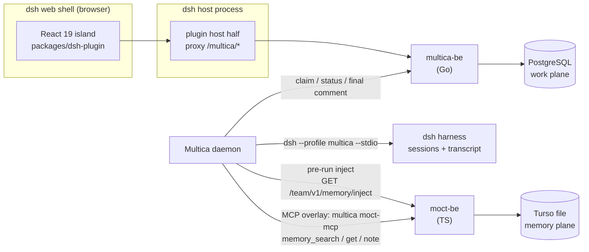

# multica-moct-x architecture

How this fork is put together: two backends, two databases, one seam, and a
dsh-native UI. This document is the map; the detail lives in
[seam.md](seam.md), [dsh-plugin.md](dsh-plugin.md),
[interactions.md](interactions.md) and [operations.md](operations.md).

Every claim below cites code in this repository (`path:line`, head of
`multica-moct`) or a decision record (M-93/M-97 threads). Facts about
`moct-be` are pinned to the live-check recorded in
[`docs/moct-seam.md`](../moct-seam.md) (moct `43960c5`, verified 2026-10-26).

## High concept

This repository is a fork of Multica (upstream `multica-ai/multica` at
`v0.6.5`, fork base `cbd75011` — recorded in
[`packages/dsh-plugin/FORK.md`](../../packages/dsh-plugin/FORK.md)) that runs
inside DeepSeek Harness (dsh) as a native plugin, backed by **two services**:

- **`multica-be`** — the fork's Go server + PostgreSQL. It owns the **work
  plane**: issues, threads, board, skills, agent registry, concurrency and
  queue.
- **`moct-be`** — the MOCT TypeScript service + Turso (libsql) file. It owns
  the **memory plane**: typed memory records, decisions/conventions, ledger,
  usage, expertise.

The two never share a database, a table or a client. They are joined by one
thin, typed, fire-and-forget seam that lives entirely inside this fork
(`server/internal/moct/`).

## Ownership: one writer per entity

The cardinal rule of the design (Architect's rule 1, M-93 decision thread,
2026-10-25): **no entity has two writers across the two backends.**

| Entity | Writer | Evidence |
|---|---|---|
| issues, comments, tasks, agents, skills, board views | `multica-be` → Postgres | server pool opens `DATABASE_URL` (`server/cmd/server/main.go:395-398`); all work-plane SQL lives under `server/pkg/db/queries/` |
| memory records (decisions, conventions, how-to-work, notes) | `moct-be` → Turso | `moct-be` runs as one process per Turso file (`deploy/dsh-z/units/moct-backend-z.service:7-9`, `deploy/dsh-z/README.md:116-118`) |
| session store / transcript | dsh (the harness) | dsh owns the loop and the session store; the daemon drives it via stdio (`server/pkg/agent/dsh.go:28`) |

There is no shared table and no foreign database handle: `server/` contains
zero `turso`/`libsql` references, and the seam package is "a pure HTTP client,
never a DB handle" (`server/internal/moct/client.go:1-3`). Multica's
migrations define no memory tables at all. `multica-be` never reads MOCT's
database and MOCT never learns Multica's auth, roles or user table
(`docs/moct-seam.md:12-17`).

## Identity split

**Multica owns execution identity (what runs); MOCT owns the knowledge
profile (what it knows).** There is no id-mapping table — the mapping is the
ref string itself, built in `server/internal/moct/refs.go:7-27`:

| Concept | Ref |
|---|---|
| workspace | `multica:ws:<uuid>` |
| agent (knowledge profile key) | `multica:agent:<uuid>` |
| issue (task scope) | `multica:issue:<uuid>` |
| project (channel scope) | `multica:project:<uuid>` |

Human Multica users are never mapped into MOCT; on writes the actor is always
the agent ref (`{kind:"member", id:"multica:agent:<uuid>"}`,
`server/internal/moctmcp/server.go:316-321`). No expert-registration step
exists — reads accept any `multica:agent:*` string (live-verified,
`docs/moct-seam.md:155-164`).

## Sessions and transcript

Decision of record (M-97, decision 4): task messages belong to the harness
layer, not Multica. What is in code today:

- The daemon runs dsh over stdio and receives a `session_id` on the `ready`
  frame (`server/pkg/agent/dsh.go:140`, consumed at `server/pkg/agent/dsh.go:476`).
- A run parked on an ask/plan question surfaces as a durable transcript line
  on the issue (M-109, `server/internal/daemon/daemon.go:9725-9741`) — see
  [interactions.md](interactions.md).

The full dsh-owned-transcript cutover (stop persisting per-step task messages
for dsh-bound tasks; keep lifecycle status, an activity line, the final
comment and a usage summary) is **in delivery as M-102** and is **not yet in
this branch**: there is no `MESSAGE_SINK` flag and no `session_ref` column in
the current head (repo-wide grep, empty). Multica still persists per-step
messages upstream-style.

## Eventual consistency

Memory and board state are eventually consistent by design — the accepted
trade-off recorded in the M-97 epic. Concretely, there is **no sync layer,
queue or retry between the two backends**:

- pre-run inject is fetched once per claim and is fire-and-forget: any error
  logs a warning and the run proceeds without memory
  (`server/internal/daemon/moct_memory.go:61-68`);
- the HTTP client has no retry, one request per call, capped at a 10 s
  timeout (`server/internal/moct/client.go:32,225-258`);
- writes happen only when an agent calls `memory_note`; moct-be's own
  near-duplicate hold makes the agent the retry mechanism
  (`server/internal/moct/client.go:222-227`).

The invariant that makes this safe: **memory never blocks a run.** See
[seam.md](seam.md#failure-mode) for the full degrade matrix.

## The fork surface

Divergence from upstream is deliberate and bounded. The full map and the
merge discipline live in [fork-and-upstream.md](fork-and-upstream.md); the
short version: 13 PRs from fork base `cbd75011` to the current head, touching
`server/internal/moct*`, two hooks in the daemon, the `dsh` runtime files, the
new `packages/dsh-plugin`, a portal container in `packages/ui`, and
`deploy/dsh-z/`.

## ADR summary

Sources: the M-93 decision thread (Owner + both Architects, 2026-10-25), the
M-97 epic, and the M-97 Phase 1 plan (Opus Architect, attached to M-97).

**Context.** The original M-93 ADR proposed one backend (MOCT) with a
Postgres→Turso shim. After the second Architect review the Owner reversed it:
two backends, two DBs.

**Decisions.**

1. Two backends, two DBs; `multica-be` stays Go + Postgres so upstream
   merges stay possible.
2. One writer per entity; the seam is one typed HTTP contract
   (`server/internal/moct/`) — both out-paths (inject + MCP tools) go through
   it.
3. Stable cross-reference IDs: memory entries tied to work items carry
   `multica:*` refs (the ref convention in `refs.go`).
4. UI: absorb then fork — the forked board and issue page mount natively in
   dsh as a React 19 island (no iframe, no loopback page); all fork imports
   funnel through one module (`packages/dsh-plugin/src/fork.ts`).
5. Map, don't rebuild: sessions, ask/plan, skill management and model
   catalog are dsh's; Multica maps onto them.

**Rejected alternatives.**

- Single backend / single Turso + Postgres shim — buys too little, costs a
  port of the whole work domain; the shim and its CI gate were dropped.
- Pointing agents at MOCT's own stdio MCP server — it opens the Turso file
  directly and would make every agent process a second writer (rule-1
  violation). Instead `multica moct-mcp` is a pure HTTP client
  (`server/internal/moctmcp/server.go:6-7`).
- Downgrading the fork to React 18 to match dsh's shell — huge divergence,
  breaks upstream merges (`packages/dsh-plugin/FORK.md`, rule 4).
- Reusing `dsh-lane-deploy.yml` for lane z — couples the proving lane to
  dsh-x's deploy train; z got its own provisioner (`deploy/dsh-z/`).

**Consequences.**

- Fork hot spots: `server/internal/moct/`, `server/internal/moctmcp/`, two
  hooks in `server/internal/daemon/`, `server/pkg/agent/dsh.go`,
  `packages/dsh-plugin/`, `deploy/dsh-z/`.
- Memory is advisory and eventually consistent; every consumer must behave
  as if MOCT can be down at any moment (it must never fail a run).
- Dropped from Multica's server feature set unless the Owner decides
  otherwise per phase: analytics/dashboard views, GitHub/Slack integrations,
  billing, autopilots, squads. In the dsh panel they are hidden, not deleted
  (`packages/dsh-plugin/src/client/navigation.ts:18-24`).

## Unverified

- **dsh-x production topology** (how the production lane is provisioned) is
  outside this repo; only lane z has its provisioner here
  (`deploy/dsh-z/`). See [operations.md](operations.md).
- **moct-be internals** (approval defaults, `layerTokens` semantics, the 403
  matrix) are pinned to moct `43960c5` via the M-98 live check recorded in
  `docs/moct-seam.md`; they are not verifiable from this checkout.
- **The full dsh-owned transcript** (M-102) is in delivery; this document
  describes only what the current head does.
