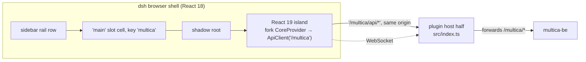

# `packages/dsh-plugin` — Multica inside the dsh shell

The plugin is how the forked Multica board and issue page appear inside
DeepSeek Harness natively — no iframe, no loopback page. Two halves in one
package ([`packages/dsh-plugin/README.md`](../../packages/dsh-plugin/README.md)):

| Face | Entry | Runs in | Owns |
|---|---|---|---|
| host | `src/index.ts` | the dsh (Node) process | `/multica` HTTP + WebSocket transport |
| client | `src/client/index.ts` | the dsh browser shell | rail row, `main` seat, the React 19 island |



## Sidebar rail rows and the main seat

The client half registers into dsh's slot system (`inject = ["slots"]`,
`packages/dsh-plugin/src/client/index.ts:20`):

- `sidebar.panellist` gets a rail row — dsh owns the button and its selection
  state; the plugin supplies the icon
  (`packages/dsh-plugin/src/client/index.ts:40-48`).
- `main` (a keyed slot) gets one cell under the key `multica`: the seat that
  mounts the island when the rail row is selected
  (`packages/dsh-plugin/src/client/index.ts:52-53`).

Routing inside the island is two views only — board and issue
(`IslandRoute`, `packages/dsh-plugin/src/client/navigation.ts:26-28`).

## React 19 island in a shadow root

dsh's shell is React 18; the fork is React 19 and must not be downgraded
(`packages/dsh-plugin/FORK.md`, rule 4). The island ships its **own React 19
+ React DOM** in the client bundle; the shell's React never renders island
components and the island never calls a shell hook. The two trees meet at one
element per component: the shell creates it, the island takes over inside.

The mount point attaches an open shadow root (`packages/dsh-plugin/src/client/island.ts:51`).
The fork's stylesheet is compiled to one string with `:root` rewritten to
`:host` and attached to that root, so Tailwind preflight and the fork's
design tokens cannot leak into dsh's document and dsh's CSS cannot leak in.
Overlays (dialogs, menus, tooltips) portal into a seat inside the same shadow
root (`src/client/seat.ts`; the portal seat ships in the fork as
`packages/ui/components/ui/portal-container.tsx`).

Underneath sits the fork's own `CoreProvider` whose `ApiClient` points at
`/multica` — the same code that serves the Multica web app, not a
re-implementation (`src/fork.ts` is the complete import list, 37 lines).

## Host proxy `/multica/*`

The browser never learns a Multica origin or token. The host half proxies
HTTP under `PROXY_PREFIX = "/multica"` (`packages/dsh-plugin/src/proxy.ts:31`) and WebSocket at
`/multica/ws` (`packages/dsh-plugin/src/proxy.ts:33`) to the server named in the plugin config,
forwarding only a small method/headers allow-list. Configuration is a normal
dsh host row in `cordis.patch.yml` (`serverUrl`, `token`,
`workspaceSlug`); `token` may be supplied as `MULTICA_DSH_TOKEN` in the dsh
process instead. A row missing either value still mounts: `/multica/config`
reports what is missing and the panel says so rather than the rail row
disappearing (`packages/dsh-plugin/README.md` § Configure).

The host half ships as emitted tsc output (dsh loads `lib/*.js` as bare Node
ESM): relative imports keep their `.ts`-resolving extensions, and `ws` is
loaded through a module-scope `createRequire` (`src/ws.ts`) because it is
CommonJS-only. Both constraints fail at dsh boot, not at build — the lane's
bundle script therefore loads the emitted entry as ESM before shipping it
(`deploy/dsh-z/build-plugin-bundle.sh`).

## Hidden areas — hide, do not delete

Surfaces the panel must not show are hidden in the island, never removed from
the fork, and stay reachable from the Multica web app. The list:

```ts
// src/client/navigation.ts:18-24
export const HIDDEN_AREAS = [
  "integrations/github",
  "integrations/slack",
  "billing",
  "autopilots",
  "squads",
] as const;
```

The refusal is enforced, not cosmetic: a hidden route logs
`[multica] <area> is not part of the dsh panel (hidden: …)`
(`packages/dsh-plugin/src/client/island-app.tsx:246`).

## The single fork entry and its lint

Nothing under `src/` may name an `@multica/*` module except **one file**:
[`src/fork.ts`](../../packages/dsh-plugin/src/fork.ts) (plus one stylesheet,
`src/client/island.css`). Enforcement is two-layered: ESLint
`no-restricted-imports` rejects any `@multica/*` specifier outside `fork.ts`
(`packages/dsh-plugin/eslint.config.mjs:19-27`), and `scripts/check-fork-entry.mjs` enforces
three rules — single-file consumption, no relative imports escaping the
package, and every specifier must be a **published export** of its package —
with `pnpm lint` running both
(`packages/dsh-plugin/package.json:44`: `eslint . && node
scripts/check-fork-entry.mjs`). A deep import fails the build, not review.

Consequences (stated in `FORK.md`): the plugin depends on the fork's public
surface only, and `src/fork.ts` is the enumerable, deliberately short list of
fork behaviour the panel depends on.

## `FORK.md` policy

[`packages/dsh-plugin/FORK.md`](../../packages/dsh-plugin/FORK.md) is the
provenance record and the divergence policy:

1. **Bases recorded**: upstream `multica-ai/multica` at `v0.6.5`; fork base
   `cbd75011`; fork of record is this repo, branch `multica-moct`.
2. **Hide, do not delete** (above).
3. **Prefer fork changes over plugin workarounds** — no CSS overrides or DOM
   surgery for behaviour; that is invisible to the gate and breaks on the
   next fork update.
4. **Transport stays on the host** — no Multica URL or token in the browser;
   needing one is an architectural change, not a plugin tweak.
5. **React 19 is not negotiable.**
6. **Record the base** — a fork-base move updates `FORK.md` in the same
   change that adapts the island, and the island tests
   (`pnpm --filter @multica/dsh-plugin test`) are re-run.

## Develop

```sh
pnpm --filter @multica/dsh-plugin build     # tsc host half + wrapped client bundle
pnpm --filter @multica/dsh-plugin test      # proxy, gate, seat, island, storage tests
pnpm --filter @multica/dsh-plugin lint      # eslint + the fork-entry gate
pnpm --filter @multica/dsh-plugin typecheck
```

`build` writes `lib/index.js` (host) and `lib/client.js` (client bundle,
wrapped by `scripts/wrap-client.mjs` in the module-loader preamble dsh
expects — generated, never hand-edited).

## Unverified

- **Behaviour inside the live shell** (modals, focus trapping, portal
  styling under real dsh) was validated on lane z by the M-99/M-103
  deployments; the automated tests cover proxy, gate, seat and island
  rendering against a stubbed backend. This doc has not re-run the lane.
- **The exact dsh slot contract** (`sidebar.panellist` list, `main` keyed
  slot) is cited from this plugin's registration code; the dsh-side slot
  definitions live in the deepseek-harness repository, not here.
