# Ask/plan interactions

When an agent needs a human decision mid-run — an "ask" (question) or a
"plan" (plan review) — dsh parks the run and the question must reach the
member where they work: on the Multica issue. This is **ask/plan parity**
(M-97 Phase 2, card S1-A / issue M-109, merged to `multica-moct` in commit
`19097b19d`).

Status of the M-115 scope items:

| Item | Status |
|---|---|
| dsh stdio `question`/`answer` frames ↔ Multica question path | **delivered** (this page describes the code) |
| `multica_ask` / `multica_plan` in a `@multica/dsh-tools` host plugin | **recorded then lost to history** — see [Unverified](#unverified) |
| timeout | harness-side exists (`ASK_TIMED_OUT`); Multica-side escalation — **design** |
| escalation to the project lead on timeout — **design** (not built) |
| schema-driven interaction item (a first-class Multica entity) — **design** (not built) |

## The delivered flow (S1-A)

```mermaid
sequenceDiagram
  participant AG as agent (dsh run)
  participant BR as dsh stdio bridge
  participant DA as Multica daemon (dsh.go)
  participant MB as multica-be / issue
  participant HM as member

  AG->>BR: ask_user_question / exit_plan_mode (plan review)
  BR-->>DA: ready frame: capabilities.questions = true
  BR-->>DA: question frame (parked; run waits)
  DA->>MB: durable transcript line "question parked"
  HM->>MB: comment on the issue (steered reply)
  MB-->>DA: supplement loop delivers the comment
  DA->>BR: answer command (selected option or custom text)
  BR->>AG: answer delivered, run resumes
```

### Frame contract (this repo, `server/pkg/agent/dsh.go`)

- **Capability gate.** The bridge advertises `questions` in its `ready`
  frame's capabilities (`dshCapabilitiesFrame`, `server/pkg/agent/dsh.go:106-112`); the
  daemon records it at `server/pkg/agent/dsh.go:473`. The whole feature is additive at
  protocol v1: a bridge that predates it never emits `question`, and the
  answer path refuses without touching stdin — its parser would reject the
  unknown `answer` command (`answerDshQuestion` guard, `server/pkg/agent/dsh.go:591-593`).
  The executable floor is the task-supplement capability, dsh `>= 0.2.1`
  (`server/pkg/agent/version.go:129-156`).
- **`question` frame** (bridge → daemon, `server/pkg/agent/dsh.go:495-511`): one frame may
  carry several questions; each is a `dshQuestion` whose wire shape mirrors
  dsh's `AskUserQuestionItem` (`server/pkg/agent/dsh.go:94-104`) — `id`, `question`,
  `detail`, `header`, `options[{label,description}]`, `multiSelect`, and an
  optional `intent` (`dshQuestionIntent`, `server/pkg/agent/dsh.go:84-92`).
- **Plan review is a tagged question.** `intent.kind == "plan-review"` means
  the question IS a plan submission: `intent.approve` names the approving
  option and `detail` carries the plan markdown (`server/pkg/agent/dsh.go:84-92`, rendering
  at `server/pkg/agent/dsh.go:565`).
- **`answer` command** (daemon → bridge, `dshAnswerCommand`,
  `server/pkg/agent/dsh.go:124-131`): `request_id` + `call_id` + one `dshAnswerItem` per
  question, each carrying `selected` (chosen option labels) and/or `custom`
  (free text).

### From member comment back to the run

The daemon renders parked questions into a transcript line on the issue
(`renderDshQuestions`, `server/pkg/agent/dsh.go:542+`) and posts it as a durable task message
of type `text` — "the member answers by commenting on the issue, and the
steered reply reaches the backend via the supplement loop"
(`server/internal/daemon/daemon.go:9725-9741`). When a supplement (steer)
instruction arrives for a dsh run with a parked question, it is routed to
`answerDshQuestion` instead of the normal instruction path
(`server/pkg/agent/dsh.go:427-433`); the steer/supplement loop itself lives
in `server/internal/daemon/task_supplement.go`.

`answerDshQuestion` (`server/pkg/agent/dsh.go:584-625`) maps the reply:

- free text answers **every** parked question as `custom`;
- the one deliberate mapping: a `plan-review` question answered with exactly
  its approve label (case-insensitive) becomes `selected: [approve]` — which
  dsh treats as the approval selection (`server/pkg/agent/dsh.go:603-609`);
- the parked state is cleared; a second steer before an answer hits
  "no question is pending" (`server/pkg/agent/dsh.go:595-597`).

### Harness side (not this repository)

Verified against the deployed dsh-z lane tree
(`/mnt/workspace/clouds/dsh-z/current`, upstream deepseek-harness ~0.2.x):

- the agent-facing tool is `ask_user_question`
  (`packages/interaction/tool-ask-user/src/index.ts:39`);
- the `user-questions` plugin parks the run, projects answers and owns the
  timeout error `ASK_TIMED_OUT` ("ask_user_question timed out before the
  user answered",
  `packages/interaction/user-questions/src/index.ts:246`);
- the `plan-review` intent, its `detail`/`approve` semantics and the
  `BAD_INTENT` rejections are specified in
  `packages/interaction/user-questions/README.md:31`; `dsh-plan-mode` sets
  the intent on the `exit_plan_mode` review question.

## Plan lifecycle

```mermaid
stateDiagram-v2
  [*] --> Running
  Running --> Parked: agent calls ask_user_question / exit_plan_mode; bridge emits question frame
  Parked --> AnsweredCustom: member comments free text; answer command with custom
  Parked --> Approved: plan-review answered with approve label; answer command with selected
  Parked --> AnsweredOption: member picks a non-approve option
  Parked --> Refused: bridge predates questions capability; answer path never engaged
  AnsweredCustom --> Running: run resumes with the text
  AnsweredOption --> Running: run resumes with the selection
  Approved --> Running: dsh records the approval, run resumes
  Refused --> [*]: question never parks
```



Timeout state is owned by the harness (`ASK_TIMED_OUT` aborts the tool);
whether Multica surfaces a timeout, re-pings, or escalates to the project
lead is **design** — see below.

## Design (not built)

These M-97 Phase-2 items are not in the current head and are labeled design
per the M-115 contract:

1. **`multica_ask` / `multica_plan` in a `@multica/dsh-tools` host plugin.**
   The M-109 implementation record describes a dsh host plugin (deepseek-harness
   fork, branch `agent/team-orchestrator/dsh-ask-plan-frames`, commit
   `4ff9205ed`) exposing `multica_ask`/`multica_plan` so a dsh-native session
   can park a Multica question directly. That branch no longer exists on the
   remote and the commit is not fetchable; the frame contract it must satisfy
   is pinned in-repo by this repo's own fixtures (`dsh_test.go` round-trip,
   old-bridge refusal, approve mapping). Porting the team-room planning tool
   into the fork is tracked as **M-114 (S1-G, backlog)**.
2. **Schema-driven interaction item.** A first-class Multica entity for a
   parked decision (schema in `server/pkg/protocol`, persisted, listed on the
   issue). Today the parked question is a plain `text` task message
   (`server/internal/daemon/daemon.go:9733-9741`); there is no `interaction` table or protocol type
   in the current head (repo-wide grep, empty).
3. **Timeout + escalation.** On `ASK_TIMED_OUT` or a stalled park: re-ping,
   then escalate to the project lead. Nothing in this repo implements
   escalation (no wakeup/escalation wiring references questions; repo-wide
   grep, empty).

## Unverified

- The `@multica/dsh-tools` host plugin source (above, item 1) — the branch
  and commit recorded in M-109 are unreachable from this workspace today;
  only this repo's protocol fixtures pin its contract.
- The harness-side line references were verified on the **lane tree**
  (`/mnt/workspace/clouds/dsh-z/current`), not on a pinned deepseek-harness
  commit; the lane's harness version moves independently of this repo.
- No live end-to-end ask/plan run was executed while writing this document;
  the S1-A acceptance run is recorded on issue M-109.
