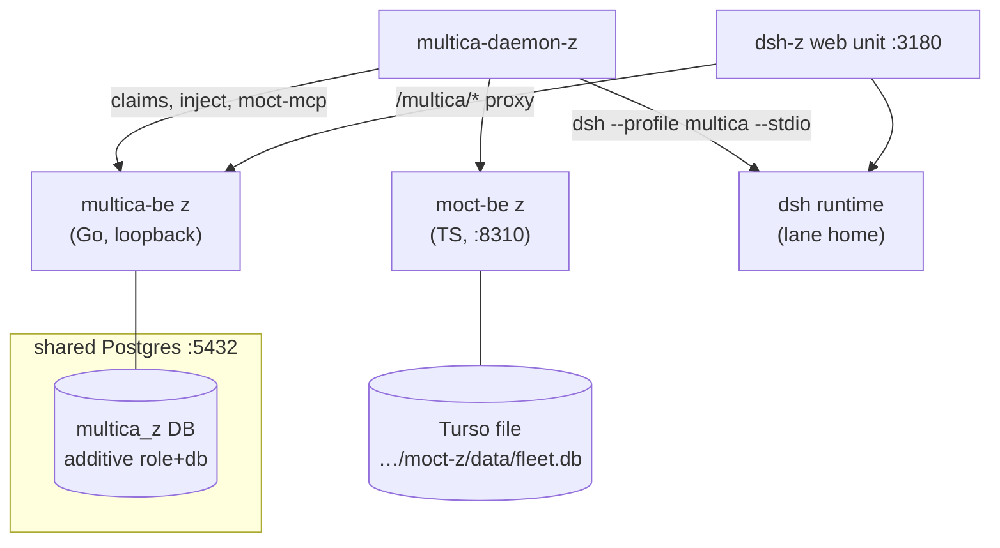

# Operations — lanes, deploy, CI, runbooks

## Lane model

| Lane | Role | Deployed from | State |
|---|---|---|---|
| **dsh-z** | proving lane: Multica + MOCT inside the dsh web shell, everything loopback-only on workspace disk | `deploy/dsh-z/` **in this repo** | live, provisioned by `deploy.sh` |
| **dsh-x** | production (the live Multica control plane and its dsh) | **outside this repo** | only "do not touch" references in-repo (`deploy/dsh-z/README.md:14-16`, `deploy/dsh-z/deploy.sh:15-16`); cutover tracked as M-112 (S1-E, backlog, Owner approval required) |

Lane z's contract (`deploy/dsh-z/README.md:10-16`,
`deploy/dsh-z/deploy.sh:11-21`): it manages only its own three systemd user
units (`multica-be-z`, `moct-backend-z`, `multica-daemon-z`), adds only its
own `multica_z` role/database to the shared Postgres cluster, never kills a
process by PID, and never talks to the live control plane. Its web unit is
explicitly marked `"NOT prod: 'rotating test lane'"` (`deploy/dsh-z/deploy.sh:16-19`).

## Deploying lane z

`bash deploy/dsh-z/deploy.sh` from anywhere (`deploy/dsh-z/README.md:6-7`) —
"the only file you run". Idempotent, phases 0–11, releases keyed by commit
sha (`deploy/dsh-z/deploy.sh:42-563`): preflight (protected-port and Postgres checks),
runtime secrets (written to `LANE_RUNTIME_ENV`, mode 0600), Postgres
role/db, Go release build from `MULTICA_X_REPO@MULTICA_X_REF`, migrate,
moct-be package from `MOCT_REPO@MOCT_REF` (with a `BUILD_INFO` rewrite that
dies if it fails, `deploy/dsh-z/deploy.sh:204-206`), unit installation, readiness waits,
auth/PAT/workspace bootstrap, profile `z` login + daemon env rewrite
(including `MOCT_BASE_URL`, `deploy/dsh-z/deploy.sh:373-374`), dsh runtime + plugin
bundle install (9b/9c), verify (phase 10), lane web restart (phase 11).

Companion scripts: `build-plugin-bundle.sh` packages `@multica/dsh-plugin`
without editing `lib/` (`deploy/dsh-z/build-plugin-bundle.sh:14-16`) and load-checks the
emitted entry as ESM (`:96-106`); `lane-cli.sh` runs the multica CLI against
the lane after **stripping every `MULTICA_*` env var** — resolution order is
flag > env > profile, so a daemon-managed environment would silently target
the live control plane (`deploy/dsh-z/lane-cli.sh:5-14,27-33`); `pnpm-shim/pnpm` pins the
profile's `packageManager` via corepack (`deploy/dsh-z/pnpm-shim/pnpm:18-36`).

## Environment variables (names only)

Committed lane config is `deploy/dsh-z/dsh-z.env` (non-secret). Names the
fork's code actually reads:

| Var | Read by | Purpose |
|---|---|---|
| `MOCT_BASE_URL` | daemon (`server/internal/daemon/config.go:637`); stdio server (`server/cmd/multica/cmd_moct_mcp.go:19`) | **the seam switch** — see [seam.md](seam.md) |
| `MOCT_WORKSPACE_ID`, `MOCT_EXPERT_ID`, `MOCT_TASK_REF`, `MOCT_CHANNEL_REF` | `server/cmd/multica/cmd_moct_mcp.go:19-23` | scope env for `multica moct-mcp` (set by the daemon, never by hand) |
| `MULTICA_BIND_HOST` | server (`server/cmd/server/main.go:375`) | bind address; lane z pins loopback (M-106) |
| `DATABASE_URL` | server (`server/cmd/server/main.go:395-398`) | Postgres work plane |
| `MULTICA_DSH_PATH`, `MULTICA_DSH_MODEL` | daemon (documented in `CLI_AND_DAEMON.md:423-424`) | dsh binary path/profile |
| `MULTICA_DSH_SERVER_URL`, `MULTICA_DSH_TOKEN` | plugin host fallbacks (`packages/dsh-plugin/src/proxy.ts:81-86`) | transport config fallback |
| `MULTICA_SERVER_URL`, `MULTICA_TOKEN`, `MULTICA_WORKSPACE_ID` | CLI | **live-control-plane hazard** — always strip when driving the lane (`deploy/dsh-z/lane-cli.sh:5-14`) |

Lane-only names (`LANE_*`, `MULTICA_Z_*`, `MOCT_Z_*`, `DSH_Z_*`) are listed
in `deploy/dsh-z/dsh-z.env:7-105`; runtime secrets (`MULTICA_Z_DB_PASSWORD`,
`MULTICA_Z_JWT_SECRET`, `MULTICA_Z_DEV_CODE`, `MULTICA_Z_PAT`) are generated
into `LANE_RUNTIME_ENV` and never committed. **Names only — this repository
contains no credential values.**

## Health checks

| Surface | Endpoint | Definition |
|---|---|---|
| multica-be liveness | `GET /health` | `server/cmd/server/router.go:1439`, `server/cmd/server/health.go:69-76` |
| multica-be readiness | `GET /healthz` (+ `/readyz`) — DB ping + applied-migration count | `server/cmd/server/router.go:1440-1441`, `server/cmd/server/health.go:19-25` |
| moct-be | `GET /team/v1/health` (deploy also waits on `/health`) | `deploy/dsh-z/deploy.sh:291-293,546` |
| seam smoke | live `GET /team/v1/memory/inject` must 200 | `deploy/dsh-z/deploy.sh:547-553` |
| lane daemon | `GET http://127.0.0.1:<19514+profile-offset>/health` (profile `z` → 19637) | `server/internal/daemon/config.go:71`, `server/cmd/multica/cmd_daemon.go:282-294` |
| lane web | `http://127.0.0.1:3180/` within 60 s | `deploy/dsh-z/deploy.sh:568-569` |

`deploy.sh` phase 10 fails the deploy unless all of `/health`, `/healthz`,
`/team/v1/health`, the inject 200, `agent list` and `issue list` pass
(`deploy/dsh-z/deploy.sh:542-558`).

## CI — what "green" means here

A PR into `multica-moct` runs exactly one workflow, `CI`
(`.github/workflows/ci.yml:6-9`). Jobs are path-scoped through
`.github/ci-paths.json` + `scripts/ci-scope.mjs` (fail-closed gate: every
selected job `success`, every unselected `skipped`,
`scripts/ci-scope.mjs:37-46`). The scopes are `frontend, backend, sqlc, runtime,
quality, scripts, installer, images` — **`deploy/dsh-z/**` matches none**
(only `deploy/helm/**` is listed, under `scripts`). Consequences:

- a PR touching only `deploy/dsh-z/**` is green with the `changes` job and
  the aggregate gates over *all-skipped* work — no build/test runs;
- `server/**` changes pull the full backend gate (`backend-tests` with
  Postgres+Redis services, `backend-agent-tests`, `go-vulnerability-scan`);
- `package.json`/`pnpm-lock.yaml`/`turbo.json`/`ci.yml` pull the frontend
  scopes.

## Known hazards (with committed mitigations)

1. **Postinstall cross-lane writes.** The lane web profile's `package.json`
   once carried a `postinstall` that wrote into dsh-x's `node_modules` on
   every lane install. Mitigation: the profile has **no `scripts` block**, and
   `dsh plugin` is never passed `--ignore-scripts`
   (`deploy/dsh-z/README.md:66-70`).
2. **pnpm 10 vs 12.** The repo pins `pnpm@10.28.2`
   ((repo-root `package.json:37`)) while the lane web profile's `node_modules` was built
   by pnpm 12; a mismatched global pnpm aborts with
   `ERR_PNPM_ABORTED_REMOVE_MODULES_DIR_NO_TTY` because dsh has no TTY
   (`deploy/dsh-z/README.md:71-76`). Mitigation: `pnpm-shim/pnpm` (corepack-pinned),
   first on `PATH` for every `dsh plugin` call (`deploy/dsh-z/deploy.sh:474-477`).
3. **Bundle rewrites.** The plugin's emitted `lib/` must ship as tsc/Vite
   emitted it; the bundle script refuses to edit it and load-checks it
   instead (`deploy/dsh-z/build-plugin-bundle.sh:14-16,96-106`). Mitigations 1–3 landed
   as S1-D (M-111, commit `7f893f0d3`).
4. **Live-control-plane leakage.** Inside a daemon-managed task the
   environment carries `MULTICA_*` vars pointing at the live server; the
   lane wrapper strips them (`deploy/dsh-z/lane-cli.sh:5-14`). Never call the CLI for the
   lane without the wrapper.
5. **Turso file exclusivity.** One process per Turso file by design; that is
   why lane z runs its own `moct-be` instance with its own file
   (`deploy/dsh-z/README.md:116-118`).

## Runbooks

| Symptom | Handling (in code) |
|---|---|
| `MOCT_BASE_URL` malformed | inject path warns `moct: base URL invalid; running without memory` and proceeds (`server/internal/daemon/moct_memory.go:54-59`); MCP overlay skipped with a warning (`server/internal/daemon/daemon.go:7975-7978`) |
| moct-be down / slow / 5xx | warn `moct: pre-run inject failed; running without memory` (`server/internal/daemon/moct_memory.go:62-67`); tool calls answer `isError:true`, the stdio server never exits (`server/internal/moctmcp/server.go:17-24`); max added latency is the 10 s client timeout (`server/internal/moct/client.go:34-37`) |
| pnpm abort on `dsh plugin` | shim refuses profiles without a `packageManager` pin; manual fallback documented at `deploy/dsh-z/README.md:78-85` |
| port taken / protected | deploy dies and tells you to pick another port in `dsh-z.env` (`deploy/dsh-z/deploy.sh:48-56`) |
| Postgres container missing | die `postgres container … is not running` (`deploy/dsh-z/deploy.sh:62-63`) |
| backend/moct/web never healthy | journal tail dumped, deploy dies (`deploy/dsh-z/deploy.sh:287-292,568-569`) |
| expected journal noise on z | PG16-vs-PG17 docs deviation (`deploy/dsh-z/README.md:98-102`); pprof `6060` disabled on the second instance (`deploy/dsh-z/README.md:113-115`) |

## Unverified

- **dsh-x production topology and its deploy** — not in this repo; only its
  do-not-touch contract is. The S1-E cutover (M-112) is backlog and
  Owner-gated.
- Commit→file attribution for the S1-D mitigations was cross-checked via
  `git log` (commit `7f893f0d3` exists with that title) but the mapping to
  individual lines is inferred from the current tree.
- Port numbers and paths here come from committed non-secret files
  (`dsh-z.env`, README, scripts); the live lane state was not re-examined
  while writing this document.
- `pnpm/action-setup@v4` in CI inheriting the version from `packageManager`
  (no `version:` input passed, `.github/workflows/ci.yml:110-111`) is action behaviour, not
  stated in-repo.
