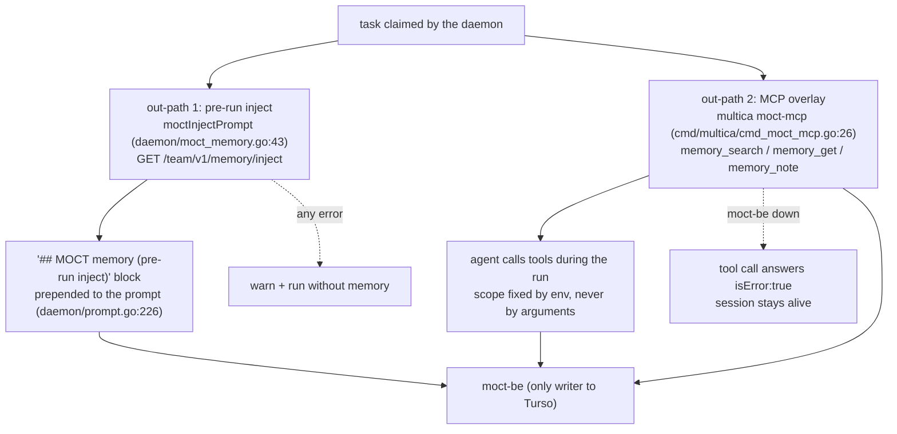

# The MOCT seam

The seam is the only way anything in this fork talks to `moct-be` (the memory
plane). The **contract** — ref grammar, endpoints, write semantics, scope
rules — lives in [`docs/moct-seam.md`](../moct-seam.md) and is kept in sync
with the code (drift-checked against head of `multica-moct`). This page is the
operator/developer map; when the two disagree, `docs/moct-seam.md` and the
code win.

## Where the code is

| Piece | Location | Role |
|---|---|---|
| HTTP client (the only one) | `server/internal/moct/client.go` | 4 endpoints under `/team/v1` (`server/internal/moct/client.go:37`); no auth headers (`server/internal/moct/client.go:236-240`); 1 MiB body cap, 10 s timeout (`server/internal/moct/client.go:32,35`) |
| Wire types | `server/internal/moct/types.go` | mirrors moct-be's team-memory JSON, schema v8 |
| Ref builders | `server/internal/moct/refs.go:7-27` | the four `multica:*` prefixes, pure string concatenation |
| Errors | `server/internal/moct/errors.go` | `ErrUnavailable` (transport) vs `APIError` (moct-be answered 4xx/5xx) |
| Pre-run inject hook | `server/internal/daemon/moct_memory.go:43-70` | called on claim inside `runTask` (`server/internal/daemon/daemon.go:8489-8491`) |
| MCP overlay entry | `server/internal/daemon/moct_memory.go:155-198` | merged into the task's MCP config (`server/internal/daemon/daemon.go:7965-7983`) |
| Stdio MCP server | `server/internal/moctmcp/` | `memory_search`, `memory_get`, `memory_note` (`server/internal/moctmcp/tools.go:8-104`) |
| CLI subcommand | `server/cmd/multica/cmd_moct_mcp.go:26-43`, registered at `server/cmd/multica/main.go:91` | the running `multica` binary — no second artifact |
| Config switch | `server/internal/daemon/config.go:637,170-176` | `MOCT_BASE_URL` |

`multica-be` (the server process) never reads `MOCT_BASE_URL` and never calls
MOCT; the seam is daemon-side only.

## Ref convention (summary)

`multica:ws:<uuid>`, `multica:agent:<uuid>`, `multica:issue:<uuid>`,
`multica:project:<uuid>` — exact strings, matched by moct-be, no parsing
anywhere (`server/internal/moct/refs.go:3-6,15-27`). Placement rule that bites: an issue ref goes
in home refs, scope params and inject's `taskRef` — **never** in a note's
`taskRef` field, which accepts `task:…` only; `NoteParams` therefore has no
`taskRef` field at all (`server/internal/moct/client.go:216-219`). Full table:
`docs/moct-seam.md` § Ref convention.

## Pre-run inject

On claim, the daemon fetches the block once and carries it on
`promptOptions` so a fresh-session retry reuses it instead of refetching
(`server/internal/daemon/daemon.go:8484-8491`). It is the one run-scoped prompt element that is
**prepended** ahead of the task instruction (`server/internal/daemon/prompt.go:226-232`), rendered
as `## MOCT memory (pre-run inject)` with one `#### [type] title` entry
(`server/internal/daemon/moct_memory.go:103-143`). A task with no workspace or agent skips the seam
entirely (`server/internal/daemon/moct_memory.go:76-78`).

## On-demand tools (`multica moct-mcp`)

A newline-delimited JSON-RPC stdio server (`server/internal/moctmcp/server.go:120-152`) that
the daemon adds to every dsh task's MCP config under the server name `moct`.
Refs are passed as **env** (`MOCT_BASE_URL`, `MOCT_WORKSPACE_ID`,
`MOCT_EXPERT_ID`, `MOCT_TASK_REF`, `MOCT_CHANNEL_REF` —
`server/internal/daemon/moct_memory.go:175-182`), never as tool arguments: a run cannot read or
write outside its own scope. The merge rule is the same by-name,
overlay-wins rule as the per-task MCP overlay
(`server/internal/handler/mcp_overlay.go:22-25`, mirrored in
`server/internal/daemon/remote_mcp_broker.go:449-474`).

Write semantics the agent sees: near-duplicate titles hold the write
(`nearMatches`, resend with `confirmNew: true`); under moct-be's default
approval policy a worker's `rule`/`decision`/`how_to_work` lands `pending`
and does not inject until approved; a task home accepts `decision` only
(`server/internal/moctmcp/tools.go:67`).

## Config switch

One variable, `MOCT_BASE_URL` (e.g. `http://127.0.0.1:8310` on lane z,
`deploy/dsh-z/dsh-z.env`, `LANE_MOCT_BASE_URL`), read by the daemon
(`server/internal/daemon/config.go:637`) and forwarded verbatim to the stdio server. Unset — the
default everywhere but a moct lane — the seam is fully off: no inject block,
no MCP entry, no warning (`server/internal/daemon/moct_memory.go:44-46,147-149`). There is no
default value.

## Failure mode — memory never blocks a run

| Failure | Behaviour | Where |
|---|---|---|
| seam off (no `MOCT_BASE_URL`) | silent no-op | `server/internal/daemon/moct_memory.go:44-46` |
| unparseable base URL | warn, run without memory | `server/internal/daemon/moct_memory.go:52-59` |
| moct-be down / timeout / 5xx | warn, run without memory | `server/internal/daemon/moct_memory.go:61-68` |
| MCP merge failure | warn, run continues | `server/internal/daemon/daemon.go:7979-7980` |
| tool call while moct-be down | `isError:true` result, process stays up | `server/internal/moctmcp/server.go:204-224` |

The stdio server must never exit: an ACP/dsh runtime fails a whole session
when an MCP server exits, which would be exactly the "memory blocks a task"
failure the contract forbids (`docs/moct-seam.md:126-132`). Worst case a slow
moct-be adds to a claim is the client's 10 s timeout (`server/internal/daemon/moct_memory.go:20-21`).

## Phase 2 additions (design, not built)

- **S1-B — session/usage writeback** (M-110, backlog): write usage and
  `session_ref` facts back to MOCT. The seam-back path today is only
  `memory_note` from within a run; nothing daemon-side writes usage to MOCT
  in the current head (repo-wide grep for moct usage under
  `server/internal/daemon/`, only the two hooks above). Labeled design until
  M-110 merges.
- **Approval UI** for pending memory records: design only (M-97 Phase 2
  list); no code in this repo renders MOCT approvals.

## Unverified

- moct-be's default `layerTokens` (1000), `expertApproval:"required"` and the
  type/403 matrix are external claims pinned to moct `43960c5` via the M-98
  live check (`docs/moct-seam.md:153-164`); not verifiable from this
  checkout.
- The live-check evidence itself (raw request/response captures) is attached
  to issue M-98, not stored in this repo.
